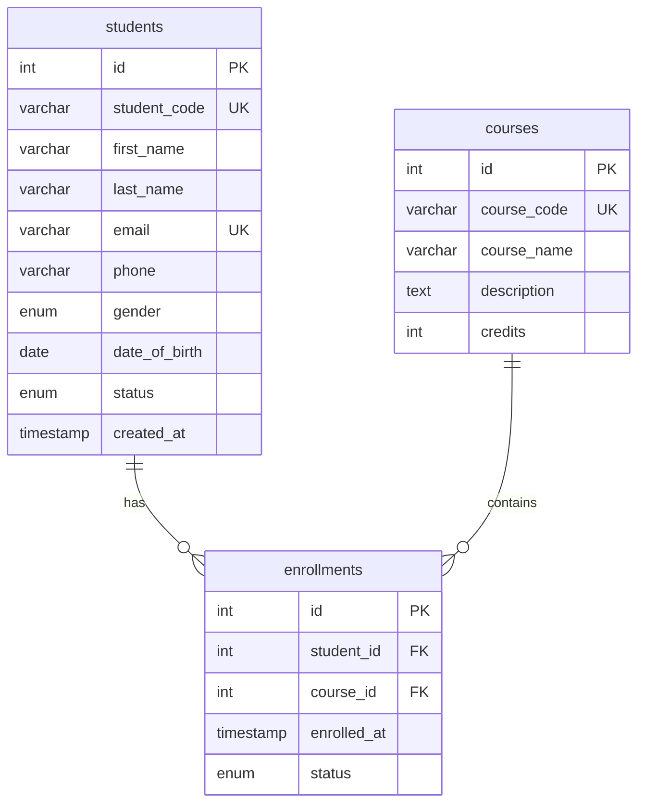

# Student Management System — Project Plan

## Problem statement

School administrators need a consistent way to maintain student records, course offerings, and enrollment relationships. Separate spreadsheets allow duplicate information and broken relationships and make searching and counting difficult.

## Objectives

1. Deliver complete student CRUD and fast name/code/email search.
2. Manage course and enrollment lifecycles with relational integrity.
3. Provide an accessible, responsive dashboard with live API-backed data.
4. Demonstrate MRC architecture, REST contracts, validation, prepared SQL, and honest QA reporting.

## Scope and stack

Included: overview totals and recent students; CRUD/details/search for three modules; modal forms, loading/empty/error states, confirmation, and notifications. No page reloads for CRUD. The original capstone excludes grades, attendance, payments, and pagination. The deployment extension below adds a single-admin production gate and prepares public hosting; multi-user roles and identity remain excluded.

Backend: Node.js, Express 5, dotenv, mysql2/promise. Database: MySQL with pooled connections. Frontend: HTML5, CSS3, vanilla JavaScript ES modules, native fetch and DOM APIs. Tests use Node's built-in test runner and assert library.

## Architecture

Browser → same-origin `/api` routes → controllers → models → mysql2 pool → MySQL.

Routes map HTTP verbs and paths. Controllers validate input, map results, and set statuses. Models own parameterized SQL. Shared helpers retain per-resource MRC modules while avoiding duplicated CRUD code. Central error middleware maps validation, uniqueness, and foreign key errors into JSON. Express also serves the static frontend, so no CORS configuration or frontend server is necessary. DOM text is escaped before insertion; input is trimmed and emails are normalized to lowercase.

## ERD

Students and courses have a many-to-many relationship through enrollments. Each enrollment belongs to exactly one student and one course. A unique `(student_id, course_id)` constraint prevents duplicate pairs regardless of status. RESTRICT on parent deletion/update protects all enrollment history; administrators must explicitly remove related enrollments before deleting parents.

## Database data dictionary

All primary keys are unsigned INT auto-increment. Strings use utf8mb4 and case-insensitive `utf8mb4_unicode_ci` collation; code/email uniqueness is therefore case-insensitive.

| Table | Column | SQL type | Constraints / meaning |
| --- | --- | --- | --- |
| students | id | INT UNSIGNED | PK, auto-increment |
| students | student_code | VARCHAR(20) | Required, unique |
| students | first_name | VARCHAR(100) | Required |
| students | last_name | VARCHAR(100) | Required |
| students | email | VARCHAR(150) | Required, unique |
| students | phone | VARCHAR(20) | Nullable; API converts empty input to null |
| students | gender | ENUM | Male, Female, Other; nullable, default null |
| students | date_of_birth | DATE | Nullable, API rejects invalid/future dates |
| students | status | ENUM | Active (default), Inactive |
| students | created_at | TIMESTAMP | Required, server-generated CURRENT_TIMESTAMP |
| courses | id | INT UNSIGNED | PK, auto-increment |
| courses | course_code | VARCHAR(20) | Required, unique |
| courses | course_name | VARCHAR(150) | Required |
| courses | description | TEXT | Nullable; API defaults null and caps at 10,000 chars |
| courses | credits | INT | Required, CHECK between 1 and 30 |
| enrollments | id | INT UNSIGNED | PK, auto-increment |
| enrollments | student_id | INT UNSIGNED | Required FK students.id; part of unique pair |
| enrollments | course_id | INT UNSIGNED | Required FK courses.id; part of unique pair |
| enrollments | enrolled_at | TIMESTAMP | Required, server-generated CURRENT_TIMESTAMP |
| enrollments | status | ENUM | Enrolled (default), Completed, Dropped |

## REST contracts

Base `/api`; all bodies are JSON objects. Responses use `{success:true,data:...}` or `{success:false,error:"..."}`. Lists return arrays; details/create/update return a record. Dates are strings; optional birth date can be null. IDs and credits return as numbers. DELETE has no response body. Unknown input fields are ignored and never form SQL identifiers.

For each resource `students`, `courses`, `enrollments`:

| Method | Path | Input | Output |
| --- | --- | --- | --- |
| GET | /api/RESOURCE | optional q string ≤200 chars | 200 record array |
| GET | /api/RESOURCE/:id | positive unsigned integer ID | 200 record |
| POST | /api/RESOURCE | validated resource body | 201 created record |
| PUT | /api/RESOURCE/:id | full editable required fields | 200 updated record |
| DELETE | /api/RESOURCE/:id | valid ID | 204 empty |

Student required body fields: student_code, first_name, last_name, email. Optional: phone (null), gender (null), date_of_birth (null), status (`"Active"`). Course required: course_code, course_name, credits; description defaults null. Enrollment required: student_id, course_id; status defaults Enrolled. PUT follows the same contract as POST; optional omitted fields reset to defaults. Creation timestamps and IDs cannot be edited.

Student search covers first/last/full name, code, and email. Course search covers code, name, description. Enrollment search covers student first/last/full name, student code, course name/code, status. Searches are literal substring matches with SQL wildcard characters escaped. Lists order by descending record ID. Enrollment records also return student_code, student_name, course_code, course_name.

`GET /api/dashboard`: 200 with `data: {students:number,courses:number,enrollments:number,recent:Student[]}`. Recent has at most five students ordered by creation timestamp and ID. Totals count all records across statuses, including Completed/Dropped enrollments.

| HTTP | Use |
| --- | --- |
| 200 | Successful retrieval/update |
| 201 | Created |
| 204 | Deleted; no body |
| 400 | Invalid body, ID, query, JSON, or nonexistent student/course reference |
| 404 | Missing record or API route |
| 409 | Unique conflict or protected parent deletion |
| 413 | JSON body exceeds 32 KB Express parser limit |
| 500 | Unexpected internal/database error; generic client message |

All request-supplied SQL values use `?` parameters with `pool.execute()`. Table/field names are internal constants. Foreign key and uniqueness checks are enforced atomically by MySQL instead of relying on potentially racy preflight checks.

## Implementation plan and status

1. Inspect workspace/tools: complete; initially empty workspace, tools installed.
2. Create structure/configuration/dependencies: complete, lockfile generated.
3. Define schema/constraints/seeds: complete, imported into isolated MySQL 9.5 instance.
4. Implement student CRUD/search first, then course/enrollment modules: complete.
5. Implement overview, forms, tables, confirmations, and dynamic updates: complete.
6. Execute automated QA and document results: see the current 49-case matrix and machine-readable results.
7. Persistent database repaired; browser acceptance is included in the submission suite. Navicat GUI confirmation remains a manual demonstration.
8. Prepare a local main branch and commit with the existing GitHub repository as origin; obtain user approval before pushing.

## Functional and non-functional requirements

Functional: CRUD/detail/search for all resources, joined enrollment details, dashboard counts/recent students, input validation, confirmations, and feedback. Non-functional: preserve existing data, parameterize all input SQL, use pooled connections, avoid credential logging, maintain responsive vanilla UI, and return consistent HTTP/JSON contracts. Browser usability is checked in installed Chrome at 375, 768, and 1440px widths, with keyboard dialog checks.

## Database repair

The root cause was ER_BAD_DB_ERROR: MySQL was running but student_management did not exist. The repair imported the revised non-destructive schema and created an ignored local .env using the locally verified development connection. Field lengths, nullable phone/description/gender, and gender choices now match the revised brief. Keys remain unsigned INT consistently across parents and children. Credits retain the additional 1–30 validation constraint. The guarded legacy migration preserves compatible records and stops on incompatible data.

## Submission verification

The submission suite has 49 stable QA IDs documented in docs/qa-test.md, with actual machine-readable outcomes in docs/qa-results.json. It tests a new disposable MySQL schema and compares application-record fingerprints before/after. Browser tests use optional tooling outside runtime dependencies and instrument CRUD actions to assert that the document is not reloaded. Network failure, loading, empty state, duplicate errors, and safe text rendering are included. A 500 response is tested using a simulated pool failure and is labeled as such in the report.

Numeric IDs and credits reject arrays/booleans, and birth dates reject non-string values. Searches escape wildcard characters with an explicit SQL ESCAPE character so literal matching does not depend on MySQL backslash mode. The existing MRC and frontend designs are preserved.

## Deployment extension

The prepared deployment retains the existing MRC and static UI: GitHub Pages serves frontend-only artifacts; Render runs Express using PORT; a hosted MySQL provider stores records with verified TLS and restricted access. Production data endpoints require administrator sign-in; health checks remain public. Exact CORS origins permit the Pages domain, while database and admin credentials remain server-side. Hosting is pending account access, database provisioning, an approved source push, and live verification. See docs/deployment.md.
